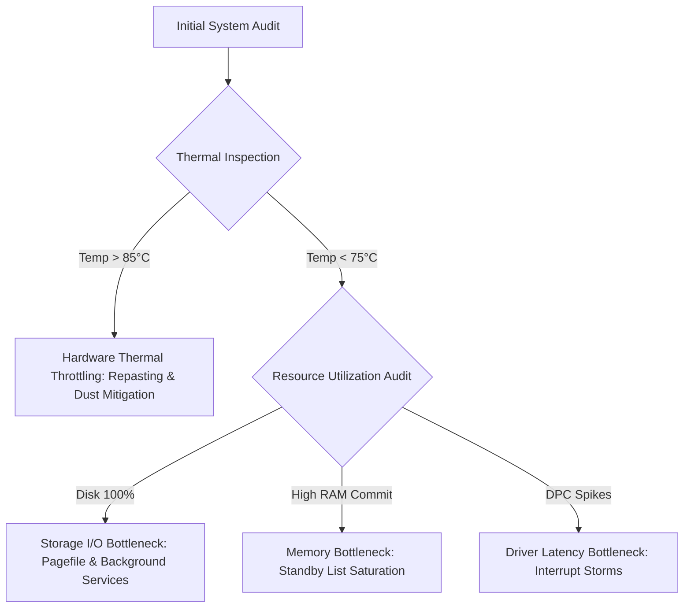

<!--
meta
{
	"title": "A Pragmatic Guide to PC System Optimization: An IT Support Perspective",
	"excerpt": "A deep dive into diagnosing hardware bottlenecks, eliminating system latency, and optimizing Windows workstations safely from a professional IT Support and Device Optimizer standpoint.",
	"date": "2026-06-15",
	"category": "optimization",
	"readTime": "8 min read",
	"tags": ["Device Optimization", "IT Support", "Hardware", "Performance Tuning", "Windows"]
}
-->
# A Pragmatic Guide to PC System Optimization: An IT Support Perspective

In an era where modern workflows demand seamless multitasking—from software engineering and virtualization to high-refresh-rate gaming and emulation—hardware performance frequently falls short of its raw potential. Out of the box, stock operating systems ship configured for maximum compatibility rather than maximum efficiency, resulting in background bloatware, unoptimized memory paging, and passive power governors that introduce micro-stutters and input lag.

As an **IT Support Specialist and Device Optimizer**, my methodology centers on a disciplined, engineering-first approach: eliminating artificial system bottlenecks while rigorously maintaining operating system integrity, data safety, and hardware thermal limits.

---

## 1. The Role of a Device Optimizer in Modern Computing

The traditional view of PC maintenance often stops at basic virus scans and disk cleanups. A dedicated **Device Optimizer**, however, operates at the intersection of operating system internals, hardware architecture, and workload-specific requirements.

### Why Default Configurations Suffer Degradation:
- **Aggressive Background Telemetry**: Modern Windows editions run dozens of background diagnostic tracking tasks that periodically seize CPU cycles and disk I/O.
- **Suboptimal Process Scheduling**: Stock thread allocation does not distinguish between low-priority background workers and critical foreground rendering loops.
- **Passive Power Profiles**: Factory power plans prioritize low power states too aggressively, causing frequency scaling latency whenever sudden computational spikes occur.
- **Fragmented Memory Management**: Accumulated standby memory caches can choke available physical RAM, forcing active applications into slow disk swap files (*paging file thrashing*).

The objective of professional optimization is not reckless overclocking, but unlocking the clean, predictable baseline that hardware was physically designed to deliver.

---

## 2. Debunking "Fake Optimization": Physics & Hardware Boundaries

The optimization industry is plagued by exaggerated claims and misleading marketplace promises. It is common to see dubious tutorials claiming "3x FPS boosts" or "zero ping" on low-end hardware through magical scripts.

As an engineer, one foundational truth must be stated: **software tuning cannot bypass the laws of physics.**

| Hardware Tier | Architectural Characteristics | Tweaking Responsiveness | Realistic Engineering Expectation |
| :--- | :--- | :--- | :--- |
| **High/Mid-End CPU** *(Intel Core i5/i7/i9, AMD Ryzen 5/7/9)* | High IPC, generous L3 cache, multi-core architecture | **High Scalability** | Significant frame pacing stability, eliminated 0.1% low FPS dips, and instantaneous desktop responsiveness. |
| **Entry-Level CPU** *(Intel Celeron, Pentium, Athlon)* | Limited physical cores (2-4), small cache buffers, constrained clock limits | **Limited Scalability** | Noticeable reductions in background stutter, but total throughput remains fundamentally bounded by physical silicon limits. |
| **Dedicated GPU** *(NVIDIA GeForce / AMD Radeon)* | Dedicated VRAM, parallel compute units, hardware video engines | **High Scalability** | Substantial reductions in frame render queue latency, optimized shader caching, and consistent frame delivery. |

> **Engineering Principle:** Any service claiming to multiply performance on entry-level hardware without hardware upgrades is either misrepresenting benchmarks or dangerously disabling fundamental system safeguards.

---

## 3. The Core Diagnostic Framework: Identifying Bottlenecks

Before altering a single configuration value, an IT Support engineer must execute a structured diagnostic pass to isolate the true performance bottleneck.

### The Four Common Bottleneck Categories:
1. **Thermal Throttling**: If a CPU reaches thermal junction maximums (*TjMax*), the internal clock frequency drops drastically to protect the die, causing sudden catastrophic framerate drops.
2. **Storage I/O Saturation**: Windows background indexing and search services saturating older mechanical hard drives or entry-level SSD controller queues.
3. **Standby Memory Exhaustion**: RAM shown as "free" being held hostage by stale application caches that fail to release memory upon high-priority requests.
4. **Deferred Procedure Call (DPC) Latency**: Outdated or misconfigured device drivers spending too much time processing hardware interrupts, causing audible audio crackling and micro-freezes.

---

## 4. Professional Workstation Optimization: Four Core Pillars

Rather than deploying black-box scripts that break Windows Update or security modules, professional optimization follows four structured, non-destructive pillars:

### Pillar I: Operating System Streamlining & Service Hygiene
- Auditing startup programs using native task management and Autoruns utilities.
- Disabling non-essential telemetry and consumer bloatware while strictly preserving enterprise prerequisites (Windows Defender, Print Spooler, Network Discovery, and Core Cryptographic Services).
- Adjusting visual effect policies to prioritize performance while maintaining font edge-smoothing (*ClearType*) for eye comfort during long engineering sessions.

### Pillar II: Memory Architecture & Standby List Maintenance
- Configuring structured memory cache hygiene to ensure physical RAM is immediately available when demanding applications initialize.
- Allocating static paging file boundaries on the fastest NVMe partition to eliminate dynamic file resizing fragmentation on system drives.

### Pillar III: Graphics Pipeline & Driver-Level Tuning
- **NVIDIA Control Panel Optimization**:
  - Setting *Low Latency Mode* to reduce pre-rendered frame queuing in GPU memory buffers.
  - Setting *Power Management Mode* to prefer maximum performance during active rendering states.
  - Expanding *Shader Cache Size* to prevent recurring compilation stutters when new assets load.
- **AMD Radeon Software Optimization**:
  - Enabling *Radeon Anti-Lag* to dynamically synchronize CPU work with GPU frame delivery.
  - Optimizing *Tessellation* modes and texture filtering quality for sustained frametime consistency.

### Pillar IV: Physical Hardware & Thermal Reconditioning
- Safe disassembly of desktop and laptop enclosures using anti-static protection.
- Removing compacted dust mats from radiator fins and blower fans.
- Applying industrial-grade non-conductive thermal interface material (*TIM*) to restore optimal heat transfer from processor heat spreaders to copper heatpipes.

---

## 5. Stability Verification & Safe Stress Testing Standards

An optimization session is never complete until the system has proven 100% stability under synthetic torture loads. A system that crashes under load is a failed optimization, regardless of how fast it runs in benchmarks.

### Verification Protocol:
1. **CPU & Memory Stress Testing**: Running multi-threaded mathematical workloads to ensure core frequency stability without arithmetic calculation errors or thermal runaway.
2. **GPU Rendering Stress Testing**: Executing continuous 3D rendering loops to observe maximum junction temperatures, fan curves, and core voltage rail stability.
3. **Real-Time Sensor Telemetry**: Monitoring per-core temperatures, package power draw (*Watts*), and memory clock frequencies using calibrated hardware monitoring tools.
4. **Productivity & Workload Simulation**: Verifying that core productivity suites, code compilers, and client-specific applications launch without missing runtime DLL dependencies.

---

## 6. Long-Term System Hygiene & Sustainable Performance

Achieving peak performance is relatively straightforward; maintaining that performance over months of daily operation requires sustainable habits:

- **Avoid Registry "Cleaners"**: Indiscriminate registry cleaning utilities frequently corrupt COM registrations and driver linkages without providing measurable performance gains.
- **Monitor Storage Free Capacity**: Solid-state drives require roughly 15–20% unallocated capacity to execute wear leveling, background TRIM cycles, and SLC cache flush routines efficiently.
- **Schedule Periodic Physical Maintenance**: Dust accumulation in laptop chassis is inevitable. A bi-annual cleaning cycle prevents thermal throttling from degrading hardware prematurely.

### Conclusion

True device optimization is an engineering discipline grounded in diagnostics, architectural understanding, and measured validation. By systematically addressing thermal constraints, operating system bloat, and graphics pipeline latency, an IT Support professional can transform an ordinary machine into a stable, highly responsive workstation built for serious production.
